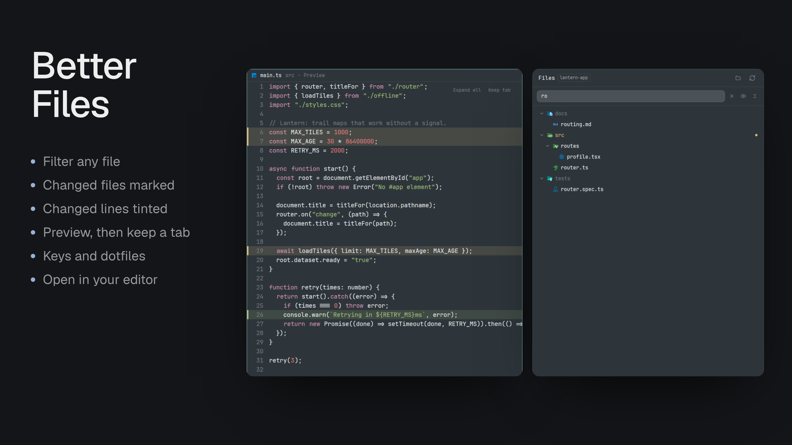
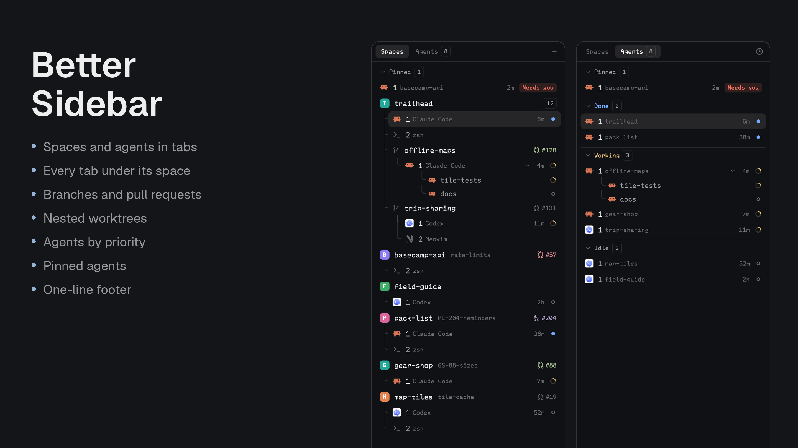
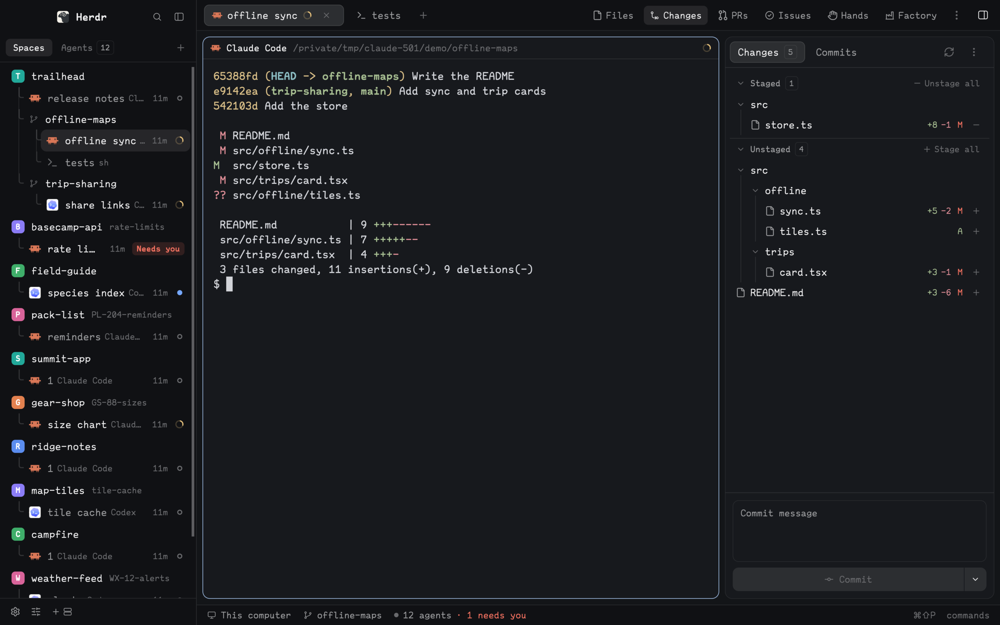

# Herdr Mods

Independent mods for [Herdr Desktop](https://herdr.dev/).


A collection of standalone mods. Choose a mod below and install only that package, or use the [Estro layout](#estro-a-layout) to get them all at once.

## Available mods

| Mod | What it does |
| --- | --- |
| [Better Changes](better-changes/README.md) | Git panel in Herdr's own style: staged, unstaged and unpushed files, stage and unstage, commit and amend, history, and a reusable inline or side-by-side diff tab. |
| [Better Sidebar](better-sidebar/README.md) | Spaces and nested worktrees with right-aligned Git branches and color-coded pull-request status from `gh`, agents grouped by main space or name prefix, and a one-line footer. |
| [Better Files](better-files/README.md) | Read-only file browser that opens files in the centre pane: a shared tab on click, kept on double-click, with Git marks, Open in your code editor, and a right-click menu that hands a file to an agent. |
| [Better Config](better-config/README.md) | Every installed mod's settings in one dialog, like Herdr's own Settings: described, checked before saving, reset in a click, and restored after an update wipes them. |
| [Better Tabs](better-tabs/README.md) | Tab bar with draggable tabs that wrap onto more lines, a toolbar for panels, and a ⋮ menu to hide and pin them. |
| [Branch PR](branch-pr/README.md) | GitHub PR sidebar that shows what stands between a PR and a merge, hands failures and comments to agents, and merges when ready. |
| [Branch Issue](branch-issue/README.md) | Linear issue sidebar that follows the branch, with an All tab, state, priority and assignee edits, comments, and worktrees that open with an agent holding the issue, waiting for your go-ahead. |
| [Hands](hands/README.md) | A `hands` CLI that gives agents hands on the Mac: read any app's accessibility tree, click, type, set values, scroll, screenshot a window, record the screen. Plus a panel with its captures, a filterable action history and its permissions. |
| [Factory](factory/README.md) | Staged agent runs: a named workflow of agents, such as developer then reviewer, shown as a tree of live sessions, with findings by severity, review loops and follow-ups. |

### Better Changes


### Better Files



### Better Config


### Better Sidebar



### Better Tabs


### Branch PR


### Branch Issue


### Hands


### Factory


## Estro, a layout

[Estro](estro/RECIPE.md) puts these mods together in one window for directing agents: every space and agent on the left, the session in the middle, and Changes, PRs, Issues, Hands and Factory on the right. *Estro* is Esperanto for the one in charge.



### Install Estro

Copy this prompt into your Herdr agent:

```text
Read ~/.config/herdr-app/AGENTS.md, then add this layout: https://github.com/munza/herdr-mods/tree/main/estro
```

**This installs all nine mods along with the layout:** Better Sidebar, Better Tabs, Better Changes, Better Files, Better Config, Branch PR, Branch Issue, Hands and Factory. You don't need to add them separately. A mod you already have is updated instead of installed again, and Factory also installs its `/factory` skill.

The agent then copies the layout, checks each mod and switches your window to Estro. It tells you what each mod can do as it goes, and if you already have a layout called `estro`, it won't overwrite it.

Four of the mods need extra tools:

| Mod | Needs |
| --- | --- |
| Branch PR | Go 1.23+ and `gh` |
| Branch Issue | Go 1.23+ and a Linear API key |
| Hands | Go 1.23+ and macOS |
| Factory | Go 1.23+ and Claude Code |

If you don't want one of them, tell the agent, and it can leave out that mod's button and block. [estro/RECIPE.md](estro/RECIPE.md) has the full steps.

## Quick install

Copy this template into your Herdr agent, replacing `<mod-folder>` with the folder name of the mod you want:

```text
Read ~/.config/herdr-app/AGENTS.md, then add this mod: https://github.com/munza/herdr-mods/tree/main/<mod-folder>
```

For example, to install Better Sidebar:

> Read ~/.config/herdr-app/AGENTS.md, then add this mod: https://github.com/munza/herdr-mods/tree/main/better-sidebar

Each mod's README covers its features and requirements; its `RECIPE.md` guides installation. Installing one mod does not install the others; to get them all, [install Estro](#install-estro).

## Versions and settings

Every mod carries a `version` in its `mods/<name>/mod.json`, and a `mod.schema.json` beside it that describes every setting with its default. The installed `mod.json` holds a `settings` block only for what you changed, so `cat ~/.config/herdr-app/mods/<name>/mod.json` shows what a Herdr has and how it differs from the defaults. Change settings in [Better Config](better-config/README.md), or edit the installed file, which an editor checks against its schema; Herdr reloads the mod at once. Mods with a Go helper have an installer that keeps your settings and prints the new and previous version on `--update`; the others are updated by copying their `mods/<name>/` folder again, after which Better Config offers to restore your settings, or you re-apply your edits. Each README lists its keys. Bump the version with any change that is worth updating for.

## Test

Requires Node.js and Go for development tests:

```sh
(cd better-changes && node --test tests/*.test.cjs)
(cd better-files && node --test tests/*.test.cjs)
(cd better-sidebar && node --test tests/*.test.cjs)
(cd better-tabs && node --test tests/*.test.cjs)
(cd branch-pr && node --test tests/*.test.cjs)
(cd branch-pr/helper && go test ./... && go vet ./...)
(cd branch-issue && node --test tests/*.test.cjs)
(cd branch-issue/helper && go test ./... && go vet ./...)
(cd hands && node --test tests/*.test.cjs)
(cd hands/helper && go test ./... && go vet ./...)
(cd factory && node --test tests/*.test.cjs)
(cd factory/helper && go test ./... && go vet ./...)
(cd estro && node --test tests/*.test.cjs)
```

The mods use Herdr's native JavaScript runtime, without Node.js at runtime. Better Changes and Better Files use Git; Better Sidebar uses Git, the GitHub CLI, and Herdr's `hc`. Better Tabs uses Herdr commands and has no external executable dependency. Branch PR uses Git, `gh`, `hc`, and a local Go helper built during installation with Go 1.23+; see its README for access and explicit write actions. Branch Issue uses Git, `hc`, and a local Go helper, built the same way, that reaches Linear with your `LINEAR_API_KEY`; see its README too. Hands uses macOS's Accessibility and ScreenCaptureKit frameworks through a Go helper built on your machine, and needs Herdr to be granted Accessibility and Screen Recording; see its README before installing. Factory uses `hc`, Claude Code, optionally the Codex CLI, and a local Go helper; it starts agent sessions, so see its README first.

## License

[Apache-2.0](LICENSE). See [NOTICE](NOTICE) for upstream attribution.
