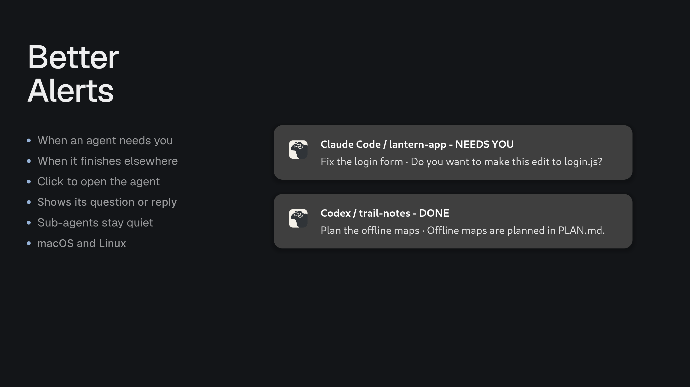

# Better Alerts

System notifications on macOS and Linux for a person directing agents in Herdr: an agent that needs them, or finishes while they're looking elsewhere, posts one saying what it asked or did, and clicking it opens that agent. Judge any addition by whether it gets the person back to an agent that's waiting, without noise.

## What you see

Nothing in Herdr's window. The mod renders an empty `div`, so its floating block takes no room. On the desktop, a notification from `Herdr` with Herdr's icon:

- **Title:** `<name> / <space> - NEEDS YOU` or `<name> / <space> - DONE`, like `Claude Code / lantern-app - DONE`; `<name> - DONE` with no space name. The name is `program.name`, else `app`, `title` or the address.
- **Tab:** the tab's name, or nothing when it's empty, named like the space, or only a number.
- **Message:** for needs you, the question on the agent's screen; for finished, how its last reply began. Cut at a word to 140 characters, with `…`. Left out when there's none.

On macOS, the tab is the subtitle and the message the body, and alerts from one agent share a thread in Notification Centre. On Linux, the body is the tab, ` · `, then the message (GNOME shows a banner's body on one line, with a newline as a plain space), with `&`, `<` and `>` escaped, since daemons read it as markup; it has one action, `default` labelled Open, which most daemons run on a click.

## How it behaves

Every 500ms, from `cx.timer.every`, never from render, it compares each agent's status in `agents()` with the last look, kept by address:

- To `blocked`: post `NEEDS YOU`.
- To `done`: post `DONE` only if it was `working` or `blocked` before, and the person isn't looking: Herdr's `window().active` is false, or `focused().tab` isn't the agent's tab.
- No change, any other status, a sub-agent (a terminal in `terminals()` with a `parent`), or a kind turned off in the settings: nothing.
- Agents present when the mod starts count as seen. A new agent posts on its first status if that's `blocked`. An agent that leaves is forgotten.

To post, it reads the agent with `hc read <address> --lines 80` (a failed read is an empty screen), and `words.js` turns agent and screen into the words, after stripping ANSI codes:

- **Question:** the lowest line ending in `?`, without box sides (`│┃║|╭╰╮╯`) or leading markers (`>❯●○◆⏺•*-`), longer than 3 characters.
- **Reply:** its end is the lowest line with a letter that isn't chrome: a prompt (`❯ › > $`), a line starting `⏵ ✻ ※ ⎿` or `[hc]`, a rule, or one holding `shift+tab`, `esc to `, `? for shortcuts`, `ctrl+<key> to` or `turn off with`/`turn off recaps`. Its start is the nearest reply marker above (`⏺ • ●` then a space, not a tool call like `⏺ Bash(`), searching no higher than the person's prompt line (`❯ ` or `› `), else the start of the end's paragraph. The lines between, cleaned, are joined with spaces.

Linux runs `sh -c 'setsid -f sh -c "$1" sh "$2" "$3" "$4" >/dev/null 2>&1 </dev/null'` with a script, the title, the body and `{"terminal":"<address>"}`, so `exec` answers at once and a click still works after its 30-second limit. The script runs `notify-send -a Herdr -i herdr-app -A default=Open -- title body`, which waits for the action; on `default` it runs `herdr-app do agent.focus <target>`, then, when `hyprctl` exists, `hyprctl dispatch 'hl.dsp.focus({ window = "class:^(herdr-app)$" })'`, which Hyprland 0.56's Lua config takes, or else `hyprctl dispatch focuswindow 'class:^(herdr-app)$'` for older Hyprland.

macOS runs a script with `<appHome>/mods/better-alerts/bin/HerdrAlerts.app`, the title, the tab, the message and the target. It finds `herdr-app` with `command -v`, then, when the app is there, runs `open -g -n <app> --args post <title> <tab> <message> <target> <herdr-app>`; otherwise `osascript` posts `display notification <message> with title <title> subtitle <where>`.

`HerdrAlerts.app` (bundle `dev.herdr-mods.better-alerts`, named Herdr, with Herdr's icon, `LSUIElement`) asks for permission (refused, it posts the same words through `osascript` itself, prints where to allow it, and exits 2), posts with `UNUserNotificationCenter`, keeping the target and the `herdr-app` path in the notification, and quits. A click launches it again with no arguments; its delegate, set before launch finishes, runs `herdr-app do agent.focus <target>` (the path it was given, else `/opt/homebrew/bin`, `/usr/local/bin` or `~/.local/bin`), then opens `dev.herdr.app` in front, and quits. Launched with no click, it quits after 10 seconds. It shows banners even while Herdr is in front.

A failed `exec` is logged once. On any platform but `linux` and `macos` (`window().platform`), it starts no timer and does nothing.

## Built from

`mods/better-alerts/`: `main.js`, `words.js` (what a notification says; no Herdr calls), `settings.js` (shared between this repo's mods), `mod.json` (`place: none`, title Better Alerts), `mod.schema.json` (its settings with their defaults, which the code's `DEFAULT_SETTINGS` must match: `alerts.blocked` and `alerts.done`, both true). It uses `agents`, `terminals`, `focused`, `window`, `appHome`, `exec` and `hc` from `herdr`, and `div` from gpui-kit. Install it as a root `floating` block, `{ "id": "better-alerts", "content": { "mod": "better-alerts" }, "edge": "bottom", "align": "end" }`, in a layout the person owns.

`helper/`: `main.swift`, `Info.plist` and `build.sh`, which compiles with `swiftc -O`, copies `Herdr.icns` from Herdr's app (found by bundle id with `mdfind`, else `/Applications/Herdr.app`), signs ad hoc with `codesign --force --sign -`, and moves the app to `bin/HerdrAlerts.app` in the installed mod (or the folder given). `sync.sh` keeps `bin/`.

## Watch out

A program run from render, or a check that runs only when render does, misses changes while Herdr draws nothing; the timer keeps it steady. `notify-send -A` blocks until the notification closes, which is why the shell is detached with `setsid -f`. Hyprland 0.56 with a Lua config rejects the classic `focuswindow` dispatcher (exit 7), and older Hyprland has no Lua one, so the script tries both. Shipped layouts are read-only, so the block goes in a layout the person owns.

On macOS, an app run straight from its binary is refused permission without a prompt; `open` launches it through Launch Services, which lets it ask. An app in a temporary folder such as `/private/tmp` is refused too. macOS remembers a refusal for that bundle id, even after the app moves, and only System Settings → Notifications undoes it; `~/Library/Group Containers/group.com.apple.usernoted` can't be read or reset. The delegate must be set in `applicationWillFinishLaunching`, or the click that launched the app is lost. `-n` starts a fresh copy, since one still waiting for a click would otherwise take the arguments' place. macOS has no `setsid`, and doesn't need it: `open` returns once the app is launched.

## Done when

- `node --test tests/*.test.cjs` and `herdr-app check` pass, and on macOS `helper/build.sh` builds.
- An agent that asks for permission posts `… / <space> - NEEDS YOU` with its tab and question, once.
- An agent finishing in a tab you aren't on, or with Herdr behind another window, posts `… / <space> - DONE` with its tab and how its reply began; finishing in the tab you're looking at posts nothing.
- On macOS the notification has Herdr's name and icon, and clicking it shows that agent with Herdr in front; on Linux, clicking Open shows that agent, and on Hyprland brings Herdr forward.
