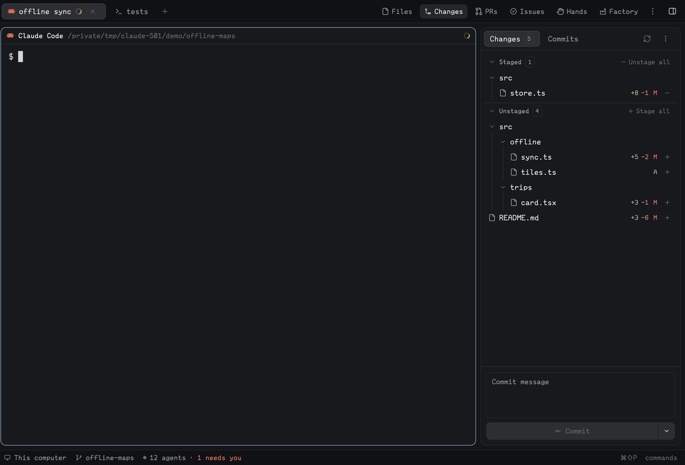

# Better Changes

A Git panel for Herdr Desktop, built to look like Herdr's own panels: staged, unstaged and unpushed files, stage and unstage, commit and amend, and history in a right sidebar, with an inline or side-by-side diff tab in the centre. For anyone who wants to check and commit what their agents changed without leaving Herdr.



## Quick start

1. Install with the prompt below, then open the Changes panel.
2. Click a changed file: its diff opens in a centre tab. Use the **⋮** menu for **Side by side**.
3. Press **+** on the files you want, type a message in the box at the bottom, and press **Commit**. Nothing is pushed.

## Install

Copy this prompt into your Herdr agent:

> Read ~/.config/herdr-app/AGENTS.md, then add this mod: https://github.com/munza/herdr-mods/tree/main/better-changes

Requires Git on each machine you use.

[RECIPE.md](RECIPE.md) guides the install. Herdr's shipped layouts are read-only and restored on start, so the panel only shows in a layout you own. On a shipped layout, your agent clones it and points its `changes` node's `content.mod` at `better-changes`. In your own layout, it asks where the panel goes. The manifest docks it on the right at 368px.

### Install by hand

Copy `mods/better-changes/` into Herdr's mods folder, `~/.config/herdr-app/mods/`. A symlink loads the code but not the icons. From a clone of the repository, `sync.sh` does the copy:

```sh
./better-changes/sync.sh
```

### A key for the panel

Bind any key to `mod.open:better-changes` in `~/.config/herdr-app/keys.json`:

```json
"global": { "cmd-alt-g": "mod.open:better-changes" }
```

It opens the panel, and selects it if it shares a stack such as Herdr's Files and Changes. On an open panel it does nothing, unless `panel.toggle` is `true`: then it closes it. A layout without the panel shows a notification.

## Use

- **Changes** lists **Conflicts**, **Staged**, **Unstaged** and **Committed** (not pushed yet) files in collapsible groups. Groups with nothing in them are hidden. The tab's badge counts changed files.
- **+** and **−** on a row stage or unstage that file; **Stage all** and **Unstage all** act on the whole repository except conflicts. Working files on disk are never touched.
- The **⋮** menu picks **Flat** or **Tree** for file lists, and **Inline** or **Side by side** for diffs.
- Clicking a file opens its diff in one reusable centre tab per space, named after the file. It comes back to that file after a restart.
- **Full file**, shown when you hover over the diff's header row, shows the whole file with its changes marked, instead of only the changed lines. It applies to every diff until you turn it off. A diff still stops at `limits.diff_lines`.
- **Syntax colours** in diffs: keywords, strings, comments, numbers, constants, function calls, types, Vue/HTML/JSX tags and attributes, and JSON/YAML keys. A block comment or template string stays coloured on the lines after it. The sign and a tinted background mark added and removed lines.
- **Commits** lists history, grouped by your branch and its remote, and opens any commit's description and changed files, with a link to GitHub for commits already pushed to an `origin` on GitHub.
- A commit box with **Commit** and **Amend**.
- **Refresh**: the refresh button rereads Git at once. Git is also read every `refresh.status`, and local repositories are watched.
- Local and remote spaces: Git and file reads run on the space's own machine.
- **Icons:** with [Better Icons](../better-icons/README.md) installed, changed files and their folders get colour icons from VS Code's Material Icon Theme, in the lists and the diff's header. Without it, files keep the plain icon and folders have none.

### Commit and amend

**Enter** makes a new line; only the button commits. The chevron beside it switches between **Commit** and **Amend** without running either.

- **Commit** creates a commit from what is staged, and needs a message and at least one staged file.
- **Amend** rewrites the latest commit with what is staged and your message, and can change just the message. Choosing it loads the latest message into an empty box, but never replaces text you wrote. If something else moved the latest commit since, it stops and asks you to choose Amend again.

Both are off while conflicts remain, and a failure keeps your message. This mod never pushes. Be careful amending a commit you have already shared.

### Conflicts

Conflicted files get their own **Conflicts** group at the top, each saying what kind it is, such as "both edited". One opens with Git's traditional `<<<<<<<`, `=======` and `>>>>>>>` markers, showing only the conflict blocks with a few lines around them and the real line numbers from the file. **Inline** shows the block as it is in the file, including the base section if your Git writes one. **Side by side** puts yours on the left and incoming on the right. It says when one side deleted the file. Showing them is all this does: resolving is left to an agent or your editor. Commit and Amend stay off until no conflicts remain.

### Commits

Your branch comes first, with the commits not pushed yet, then its remote branch. The badge on the **Commits** tab counts the unpushed ones.

On a feature branch, a third group shows the remote's default branch, `origin/HEAD`, from where your branch left it. When your branch tracks the default branch, the two share one group, labelled with both. A group says **N not pulled** when the remote has commits you lack. All of this reads the last fetch and never fetches.

A branch that was never pushed compares with `origin/HEAD`. With no remote to compare with, there is one group and no badge on the tab.

### Limits

Stage all and Unstage all apply past the file limit. Side by side pairs adjacent removed and added lines by position, not by similarity. A rename shows as a deletion and an addition. Commit links are for GitHub remotes named `origin`. A branch pushed without an upstream still compares with `origin/HEAD`.

Colors show additions and removals, not whether a person or an agent wrote the lines.

## Settings

[Better Config](../better-config/README.md) shows these with what each one does, and changes, checks and resets them for you. By hand, add a `settings` block to the installed `~/.config/herdr-app/mods/better-changes/mod.json` with only what you change, such as `"settings": { "default": { "diff": "split" } }`. Saving it applies at once. `mod.schema.json` beside it describes every setting, so an editor that reads `$schema`, such as VS Code or Zed, checks the block as you type. For the `limits`, zero falls back to the default. Unknown keys and wrong types are reported in the log and ignored.

| Key | Default | What it does |
| --- | --- | --- |
| `refresh.status` | `10s` | How often Git is read for changes. |
| `limits.files` | `1000` | The most files a list shows. |
| `limits.diff_lines` | `1500` | The most lines a diff shows, Full file included. |
| `limits.line_length` | `4000` | Longer lines in a diff are cut here. |
| `limits.commits_per_page` | `50` | How many commits load at a time. |
| `default.view` | `tree` | How file lists start (`tree` or `flat`), until you choose in the **⋮** menu. |
| `default.diff` | `inline` | How diffs start (`inline` or `split`), until you choose in the **⋮** menu. |
| `panel.toggle` | `false` | Lets the panel key close an open panel, instead of leaving it alone. |

## Update

Copy `mods/better-changes/` into `~/.config/herdr-app/mods/` again, or ask your agent to. The copy replaces the installed `mod.json`, so the settings you changed go back to their defaults: copy your `settings` block forward, or let [Better Config](../better-config/README.md) notice the reset and offer to restore each value.

## For developers

Mod commands, for keys and shown copies:

| Command | What it does |
| --- | --- |
| `better-changes.refresh` | Rereads Git at once. |
| `better-changes.changes`, `better-changes.commit` | Switch to the Changes or Commits tab. |
| `better-changes.flat`, `better-changes.tree` | Show file lists flat or as a tree. |
| `better-changes.inline`, `better-changes.split` | Show diffs inline or side by side. |
| `better-changes.open:<path>` | Opens that file's diff. |

Props `{ "mode": "diff", "space", "source", "selection" }` make a diff tab; with no props it's the sidebar.

Shared state: the diff publishes `shared("pane-heads")[pane]` = `{ title, detail, icon, add, del }`, which the header below shows, and the mod publishes `shared("mod-icons")["better-changes"]` for a tab bar that draws mod icons. [Better Files](../better-files/README.md) uses `better-changes.selection` and `better-changes.diff-tabs` to open a diff here.

### One header row

A mod can't change Herdr's pane header, which names a diff tab `better-changes`, so a diff tab has two rows: that header, then the file. To get one row, use this mod's own header, Herdr's with the file added, in a layout you own:

```json
"pane": { "header": { "content": { "mod": "better-changes" } } }
```

Terminals look the same as with Herdr's header. It's a copy of Herdr's `pane` mod, so it won't pick up later changes to it.

### Work on the mod

In `mods/better-changes/`:

- `main.js`: setup, settings and commands. `settings.js`: shared with the other mods. `panel.js`: what the panel key does, with no Herdr calls. `syntax.js`: the lexer that colours a diff's code, the same file as Better Files'.
- `git/repository.js`: following the repository, the index, history, commit and amend. `git/reads.js`: plain functions that read from Git. `git/model.js`: parsing with no Herdr calls.
- `views/sidebar.js`, `views/diff.js`, `views/pane-header.js`: the three things it can draw. `views/ui.js`: the design kit, Herdr's sizes and small components. Every look lives here, except the token colours, which are in `syntax.js`.
- `icons/`: Lucide icons, the set Herdr uses, and Herdr's own pane header icons.
- `mod.schema.json`: every setting with its default, which must match the code's `DEFAULT_SETTINGS`.
- `sync.sh`, beside `mods/`: copies the mod into Herdr, which reloads it. A symlink loads the code but not the icons.

```sh
node --test tests/*.test.cjs
herdr-app check "$PWD/mods/better-changes"
```

`herdr-app check` only draws the empty state, so a mistake in a list or the commit box shows up only in the running panel.
