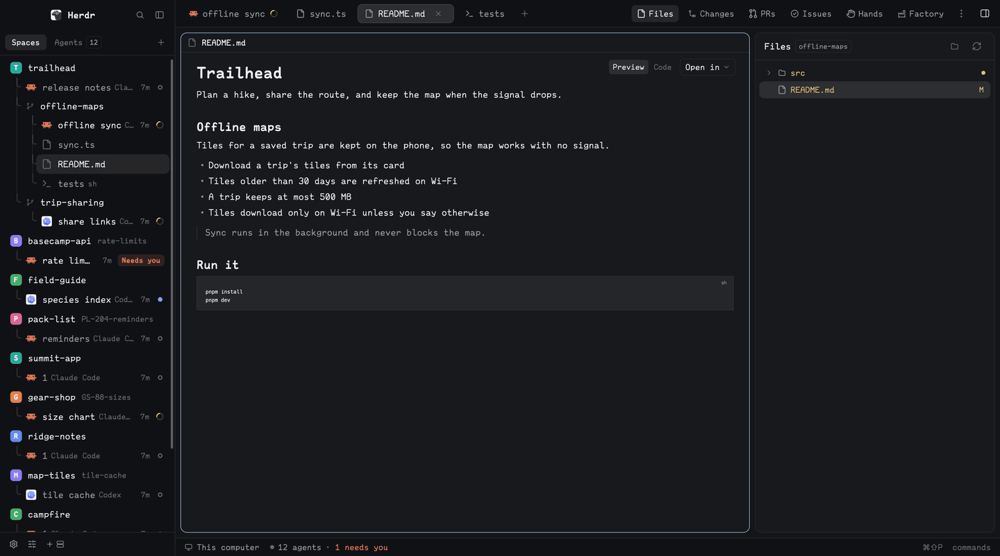

# Better Files

A read-only file browser for [Herdr Desktop](https://herdr.dev/) that opens files in the centre pane, beside your agents, with a filter that finds any file, Markdown rendered, Git marks, Open in your editor, and a menu that hands a file to an agent. Built for directing agents: see where an agent has been, read what it wrote, and hand a file to one.



## Quick start

1. Install with the prompt below, then open the Files panel.
2. Click a file to read it in the shared centre tab; double-click to keep the tab. Coloured files and lines are what changed since the last commit.
3. Right-click a file and choose an agent to send it to, with a prompt of your own.

## Install

Copy this prompt into your Herdr agent:

> Read ~/.config/herdr-app/AGENTS.md, then add this mod: https://github.com/munza/herdr-mods/tree/main/better-files

[RECIPE.md](RECIPE.md) guides the install. Herdr's shipped layouts are read-only, so the sidebar only shows in a layout you own, and the agent never overwrites an unrelated mod with the same name. Requirements: `sh`, and Git for the change marks. Finding editors uses macOS Spotlight. For colour icons, add [Better Icons](../better-icons/README.md) too.

### Place the sidebar

The manifest has `place: none`, so add it to a layout you own, or point a block that uses Herdr's `files` at it:

```json
{ "id": "files", "type": "block", "content": { "mod": "better-files" } }
```

### Install by hand

From a clone of the repository, `sync.sh` copies `mods/better-files/` into Herdr's mods folder, `~/.config/herdr-app/mods/`. A symlink loads the code but not the icons.

```sh
./better-files/sync.sh
```

## Use

Files open in the centre pane, beside your agents, instead of squeezing into the sidebar. It's built to look like Herdr's own panels.

- **Tree:** the focused pane's folder, named in the panel's title, with changed files coloured and lettered by what happened (green new, yellow edited, red gone or in conflict), and folders holding changes in yellow with a dot. It refreshes as files change. Drag a file or folder into a terminal to type its full path. Focusing a file or diff tab leaves the tree where it was.
- **Filter:** type in the box under the title to find files and folders anywhere in the folder, including ones you haven't opened. A name holding the words matches, and words with a `/` match the path. Matches show as a tree under their folders. Click a file to open it, or a folder to open it in the tree. **Enter** opens the first matching file, and **Escape** or **×** clears the box. In a Git repository, files Git ignores are left out.
- **Tools** beside the filter: the eye shows or hides dotfiles, in the tree and in the matches, and this computer remembers it. **Collapse all** closes every folder.
- **Keys:** click the tree, or press a key bound to `better-files.focus`, and the tree takes the keyboard, with a marker on a row. The included [keys.json](keys.json) suggests **Cmd+Shift+E**, as in VS Code's Explorer; merge it into `~/.config/herdr-app/keys.json`, or bind any key you like. **Up**/**Down** or **j**/**k** move, **PgUp**/**PgDn** move 10, and **Home**/**End** go to the ends. **Right** or **l** opens a folder, then steps into it; **Left** or **h** closes it, then steps out. **Enter** opens the row, **/** goes to the filter, **.** shows or hides dotfiles, and **Escape** clears the marker. In the filter box, **Up**/**Down** move through the matches and **Enter** opens the marked one.
- **Click** a file to show it in one shared centre tab, so browsing doesn't pile up tabs.
- **Double-click**, or **Keep tab**, to keep that tab. The next click starts a new shared tab.
- **The file view** is read-only, at your terminal's font size, and follows the file as it changes on disk. Only a real change touches it. Binary and unreadable files say so, and very long files are cut at 400,000 characters.
- **Changed lines:** lines that differ from the last commit are tinted, with a solid bar at their edge: green added, yellow changed, and a thin red line across the file where lines were removed. A new file is all green. Click a yellow line or the red line to open the change in place, with the old lines in red, and click again to close it. **Expand all**, beside Open in, opens or closes them all at once. They update as the file changes, and clear when it's committed. The file is drawn as rows so the colours can't drift, so text can't be selected and there's no folding. Use **Open in** for those, or turn `gutter` off.
- **Syntax colours** in the rows: keywords, strings, comments, numbers, constants, function calls, types, Vue/HTML/JSX tags and attributes, and JSON/YAML keys. A block comment or template string stays coloured on the lines after it. It's a small lexer, not a grammar, the same one Better Changes uses for diffs.
- **Images:** PNG, JPEG, GIF, WebP, BMP and SVG files show as pictures, fitted to the pane, and update when the file changes. Herdr only loads images from its own folder, so each is shown through a copy in `mods/better-files/.cache/`, removed when its tab closes.
- **Markdown:** a `.md` or `.markdown` file opens rendered, in Herdr's own Markdown view: headings, lists, tables, quotes, links and the rest, with text you can select. **Preview** and **Code**, beside Open in, switch between that and the file view with its changed lines; each tab remembers its choice, and `markdown` in settings picks the first one. A web link opens in your browser, and a link to another file here opens it in the viewer. Code blocks are drawn by Better Files: the code font at your terminal's size, syntax colours, the language at the top left and a copy button at the top right. A line of pictures shows them: Markdown images (also by reference, and in a list, like a README's badges) and HTML ``, from this computer or the web. Pictures from the web are downloaded with `curl` into the mod's cache and kept for a day, so previewing a README fetches its badges from the internet. A linked picture opens its link, and a table-of-contents link (`#heading`) scrolls to that heading. A picture inside a paragraph, or under a list item, is left to Herdr's view. The preview follows the file as it changes on disk.
  The preview uses subtle dividers under `#` and `##` headings, with extra space before new sections.
- **Icons:** with [Better Icons](../better-icons/README.md) installed, every file and folder gets its colour icon from VS Code's Material Icon Theme, in the tree and in the tab's title row. Without it, they keep the plain file and folder icons.
- **Open the whole folder** in your editor or Finder, from the folder icon beside refresh.
- **One title:** the tab's title row reads like a diff's, with the file, its folder, and Preview while it's the shared tab.
- **Open in** your code editor, from the tab or the menu. Zed, VS Code, Cursor, Windsurf, Sublime Text and Nova are offered when installed, and you can add more with `editors` in the settings.

### Right-click

Right-click a file or folder for:

| Item | What it does |
| --- | --- |
| **Open**, **Open in new tab** | In the shared tab, or a tab of its own. Files only. |
| **Open in** an editor | Each installed editor. Folders too. |
| **Open in default app** | Whatever macOS opens that file with. |
| **Show in Finder** | Reveals it. |
| **Show diff** | Opens a changed file's diff in [Better Changes](../better-changes/README.md), if you have it. |
| **Copy relative path**, **Copy full path** | For pasting into a prompt. |
| **Send to** an agent | Asks what it should do, then sends that with the path. Choose an agent that's running, **(spawn)** to start a sub-agent under it, or a new one in its own tab. Only **Send** delivers. |

The path goes to the agent and not the file's text, so it reads the file as it is by then.

A space on another machine has no editor, default app or Finder items, because those apps are on this computer, and can't show images, because the picture isn't on this computer to load.

Editing, and creating, renaming or deleting files, aren't here on purpose: that's what your editor is for, and a file browser with a delete item is a way to lose work.

### Limits

A folder lists its first 500 entries, and the tree shows 5,000 rows. The filter shows 200 matches and searches up to 40,000 files; outside a Git repository it goes 12 folders deep (5 in a home folder or `/`) and skips `.git`, `node_modules`, `.venv`, `__pycache__`, `target`, `dist` and `.next`. A file view can't report a selection or jump to a line, because Herdr's editor component offers neither, so you send whole files and an editor opens at the top.

Listing a folder needs `sh`. On a Windows computer, its own folders are listed with PowerShell instead, editors are found by their program rather than through Spotlight, and Explorer takes Finder's place. A Windows space on another machine falls back to PowerShell when `sh` is unavailable, including when the filter searches outside Git.

## Settings

[Better Config](../better-config/README.md) shows these with what each one does, and changes, checks and resets them for you. By hand, add a `settings` block to the installed `~/.config/herdr-app/mods/better-files/mod.json` with only what you change, such as `"settings": { "markdown": "code" }`. Saving it applies at once. `mod.schema.json` beside it describes every setting, so an editor that reads `$schema`, such as VS Code or Zed, checks the block as you type.

| Key | Default | What it does |
| --- | --- | --- |
| `refresh.tree` | `10s` | How often the tree rereads, on top of watching the folder. Never closer than 1 second. |
| `refresh.file` | `2s` | How often an open file is checked for changes. Never closer than 500ms. |
| `editors` | `[]` | More editors for Open in, added to the built-in list, each by macOS app ID, such as `[{ "name": "PhpStorm", "bundle": "com.jetbrains.PhpStorm" }]`. Shown only if installed. |
| `gutter` | `true` | Tint changed lines. `false` uses Herdr's own editor instead: selection, folding and a real grammar, but no line colours. Its grammars have no TypeScript or Vue, so those are highlighted as JavaScript and HTML. |
| `markdown` | `preview` | How a Markdown file first opens, `preview` or `code`. The toggle in a tab overrides it for that tab. |

## Update

Copy `mods/better-files/` into `~/.config/herdr-app/mods/` again, or ask your agent to. The copy replaces the installed `mod.json`, so the settings you changed go back to their defaults: copy your `settings` block forward, or let [Better Config](../better-config/README.md) notice the reset and offer to restore each value.

## For developers

One class plays three roles, each its own copy: sidebar, viewer and menu, connected by `shared("better-files.*")`. Viewers register in `better-files.viewers`, and the menu leaves its question in `better-files.compose` for the sidebar to ask.

The viewer publishes its title to `shared("pane-heads")`, which [Better Changes](../better-changes/README.md)' pane header shows. Show diff hands over through `better-changes.selection` and `better-changes.diff-tabs`, keyed to the Git root.

Sending to agents: a running agent gets `hc send`; **(spawn)** runs `hc run --bg --parent <agent> --cwd <folder> <program> <message>` directly, so no shell sees the message; a new agent gets `tab.new` with the message as its first prompt. On macOS, editors are found with `mdfind` by app ID and opened with `open -b`; on Windows, one PowerShell run looks in App Paths, `PATH` and the usual install folders. Changed lines come from `git diff -U0 HEAD`.

### Work on the mod

In `mods/better-files/`:

- `main.js`: lists what's where. `settings.js`: shared between the mods.
- `files/`: `model.js`, `reads.js`, `filter.js`, `file-icons.js`, and `shell.js`, which picks every shell command from `shell/<platform>.js`: `macos.js` and `windows.js`, with the POSIX commands macOS shares in `posix.js`.
- `actions/`: `open.js`, `outside.js`, `agents.js`, `menus.js`.
- `views/`: `ui.js`, `tree.js`, `filter.js`, `tools.js`, `keys.js`, `viewer.js`, `context-menu.js`. `icons/`.
- `mod.schema.json`: every setting with its default, which must match the code's `DEFAULT_SETTINGS`.

```sh
node --test tests/*.test.cjs
./sync.sh
herdr-app check "$HOME/.config/herdr-app/mods/better-files"
```

Tests use stand-ins for Herdr, and `herdr-app check` draws only the sidebar's first frame, so also look at the running app.

See [LICENSE](../LICENSE) and [NOTICE](../NOTICE) for attribution.
