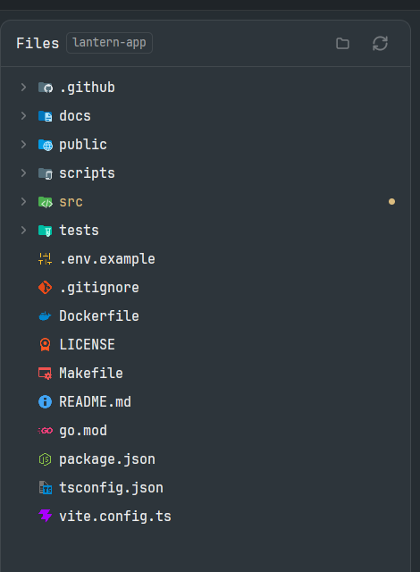

# Better Icons

The icons of VS Code's [Material Icon Theme](https://github.com/material-extensions/vscode-material-icon-theme) for the other [Herdr Desktop](https://herdr.dev/) mods. Install it beside [Better Files](../better-files/README.md) and every file and folder gets a colour icon: a TypeScript file, a `package.json`, a `.github` folder and a `src` folder each look different, and an open folder shows its open icon. Without it, mods keep their plain icons.



## Quick start

1. Install with the prompt below, beside [Better Files](../better-files/README.md).
2. Open the Files panel. Every file and folder has its Material icon, and an open folder shows its open icon.

## Install

Copy this prompt into your Herdr agent:

> Read ~/.config/herdr-app/AGENTS.md, then add this mod: https://github.com/munza/herdr-mods/tree/main/better-icons

[RECIPE.md](RECIPE.md) guides the install. It isn't a panel, so it needs no place in a layout: other mods read its icons by path. It runs no programs, reaches no network, and reads only its own folder. There are no settings.

<details>
<summary>Install by hand</summary>

To install by hand from a clone of the repository, `sync.sh` copies `mods/better-icons/` into Herdr's mods folder:

```sh
./better-icons/sync.sh
```

</details>

## Use

- **Nothing to place.** It isn't a panel: other mods read its icons by path. Shown in a layout anyway, it lists a few sample names with their icons.
- **Optional.** A mod that uses it keeps its own plain icons when it isn't installed.
- **Picked the way VS Code picks them:** a rule for a path, such as `.github/workflows`, beats a name, a name beats an extension, and the longest extension wins, so `app.spec.ts` gets the test icon and `app.ts` the TypeScript one.
- **Light themes** get the theme's light icons for the 236 names it has them for.
- 1,184 icons from Material Icon Theme 5.40.0, about 5 MB.

Mods that use it:

- [Better Files](../better-files/README.md), in its tree and its file tab's title row.
- [Better Changes](../better-changes/README.md), in its file lists and its diff's header.
- [Branch PR](../branch-pr/README.md), in a PR's Files tab.

## Limits

- About 5 MB of icons. Better Files, Better Changes and Branch PR use them so far.
- Mods reread the table when Better Icons' folder changes, so an update or an uninstall shows at once, without a restart. An install, or a folder replaced by copying, shows within 10 seconds.
- A symlinked mod folder loads code but not icons, so install by copying, as `sync.sh` does.

## Settings

Better Icons has no settings.

## Update

Copy `mods/better-icons/` into Herdr again. Mods that use it reread the table when its folder changes, so there's nothing to reopen.

## For developers

```sh
node --test tests/*.test.cjs
./sync.sh    # copies mods/better-icons/ into Herdr
herdr-app check "$HOME/.config/herdr-app/mods/better-icons"
```

### Using the icons in your mod

Copy `mods/better-icons/file-icons.js` into your mod, unchanged, because a mod can't import from another's folder. A test checks every copy in this repo matches.

Call `followFileIcons(this, cx)` in `init`: it keeps `this.fileIcons` current, null without Better Icons, and redraws the view when an install or update reaches it. Draw with `image()`, since `svg()` would tint a colour icon one colour:

```js
followFileIcons(this, cx);                    // in init
const table = this.fileIcons;                 // in render
const picture = fileIcon(table, "/repo/src/app.ts", { dir: false, open: false, light: isLight(theme().background) });
picture ? image(picture).size(14) : myOwnIcon
```

### Moving to another Material Icon Theme release

Change `VERSION` in `generate.mjs`, then:

```sh
npm pack material-icon-theme@<version> && tar xzf material-icon-theme-<version>.tgz
node generate.mjs package
```

It reads the package's `dist/material-icons.json` and copies only the icons that table names, reading only the package's JSON and SVG files. It runs none of the package's code. The tests then check every named icon is there.

### Licence

The icons are MIT-licensed, copyright (c) 2025 Material Extensions. The licence ships beside them as `LICENSE-material-icon-theme.txt`.
