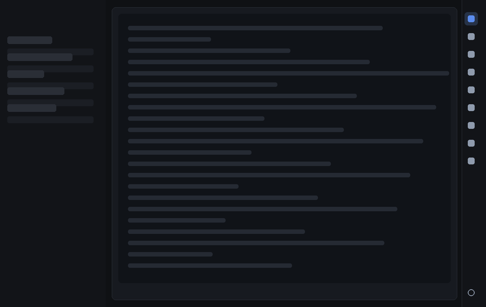

# Better Rail

A right-edge icon rail for the panels and mods you already use, instead of a row of buttons in the tab bar.



## Quick start

1. Install Better Rail, then set Better Tabs' `toolbar` setting to `rail`.
2. Click an icon to open its panel; click it again to close that panel.
3. Change the setting back to `tab` to return the buttons to the tab bar.

## Install

Copy this prompt into your Herdr agent:

> Read ~/.config/herdr-app/AGENTS.md, then add this mod: https://github.com/munza/herdr-mods/tree/main/better-rail

[RECIPE.md](RECIPE.md) guides the install. The rail is a layout block: the layout places a 46px column at the right edge, with the node id `rail`, and lists the buttons in `props.buttons`.

Better Rail copies the normal panel buttons into that block. A second 32px block at the bottom of the column draws the Mod settings button, which opens [Better Config](../better-config/README.md).

## Use

- **Panel buttons:** each selects its panel and shows the side dock. The active panel's button is highlighted; pressing it again hides the dock.
- **Command buttons:** each runs a command, such as `mod.open` for Walkthrough or Automations.
- **Switching modes:** Better Tabs owns the `toolbar` setting. `rail` hides the tab-bar buttons and shows the rail; `tab` hides the rail and shows the tab-bar buttons.
- **Mod settings:** the bottom button opens Better Config. Better Sidebar stops drawing its own Mod settings button while Better Rail is installed.

## Settings

Better Rail has no settings of its own. It follows Better Tabs' `toolbar` setting:

| Key | Default | What it does |
| --- | --- | --- |
| `toolbar` | `tab` | `tab` keeps the panel buttons in the tab bar and hides the rail. `rail` hides the tab-bar buttons and shows the rail. |

Better Config shows this under Better Tabs. By hand, add it to the installed Better Tabs `mod.json`:

```json
"settings": { "toolbar": "rail" }
```

## Update

Copy `mods/better-rail/` into `~/.config/herdr-app/mods/better-rail/` again, or ask your agent to. The layout and Better Tabs' setting stay as they are.

## For developers

- `props.buttons` is the layout's list: `{ id, label, icon, action }`.
- A `panel` action is `{ type: "panel", container, stack, target }`; pressing it selects and shows that panel, or hides the container when it is already active.
- A `command` action is `{ type: "command", name, args }`; pressing it runs the same command a key would.
- Better Tabs publishes `better-tabs.toolbar` in shared state. The rail shows itself for `rail`, and hides the layout node `rail` for `tab`.
- The bottom block uses `props.part: "config"` and opens Better Config.
- `main.js` draws and acts; `model.js` has the layout lookup, active check and button filter, with no Herdr imports.

```sh
./sync.sh
herdr-app check mods/better-rail
node --test tests/*.test.cjs
```

## License

Apache-2.0.
