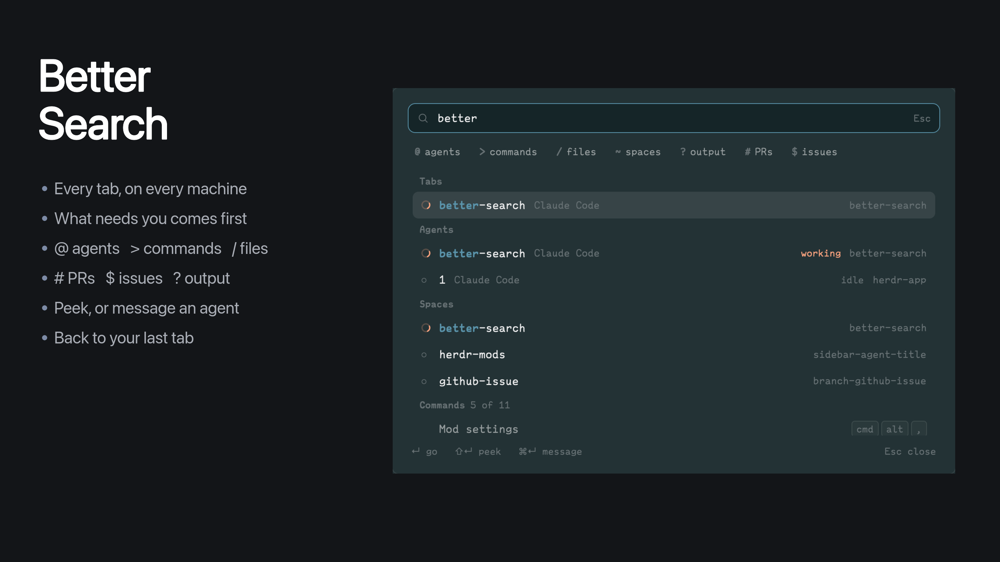

# Better Search

One popup for [Herdr Desktop](https://herdr.dev/) that finds anything: any tab on any machine, your agents, spaces, files and Herdr's own commands. It works like Cmd+P and Cmd+Shift+P in one, and can hand a message or a file straight to an agent.



## Quick start

1. Install with the prompt below, and let the agent bind **⌘⌥P**.
2. Press ⌘⌥P: every open tab is listed, the ones that need you first. Pick one and press Enter.
3. Press ⌘⌥P and Enter to go back to the tab you were in before.
4. Type `>` for commands, `@` for agents, `/` for files, `~` for spaces, `?` for what agents printed, `#` for pull requests or `$` for issues, or click its chip under the search box.

## Install

Copy this prompt into your Herdr agent:

> Read ~/.config/herdr-app/AGENTS.md, then add this mod: https://github.com/munza/herdr-mods/tree/main/better-search

[RECIPE.md](RECIPE.md) guides the install. It's a popup, so it needs no place in a layout. It runs `git` to list a space's files and `hc` to list machines and send messages, and reaches no network.

### Open it

[keys.json](keys.json) suggests **⌘⌥P**, which nothing in Herdr uses. The agent merges it into `~/.config/herdr-app/keys.json` when you agree:

```json
{ "global": { "cmd-alt-p": "mod.open:better-search" } }
```

To use another key, change **Key** in [Better Config](../better-config/README.md). It moves the binding in your `keys.json` for you. Set it to `cmd-p` to replace Herdr's picker, or `cmd-shift-p` to replace its command palette: the key is taken over, and Better Config remembers what it did, so changing the setting again gives it back.

Herdr stops adding new default shortcuts to a `keys.json` you've edited, so if you've never changed yours, this edit makes it yours. Without a key, `herdr-app do mod.open '{"name":"better-search"}'` opens it too. The same key, or Esc, closes it.

## Use

- **Your tabs first:** with nothing typed, it lists every open tab in every space on every machine in one list, each with what runs in it after its name and its space on the right. The ones that need you or have finished come first, with how long ago, such as "needs you · 3m".
- **Why it needs you:** a tab whose agent is waiting shows the question on its screen, such as "Do you want to make this edit to login.js?", in place of the program's name.
- **Back to the last tab:** it opens on the tab you were in before, marked "last", so ⌘⌥P then Enter flips between two tabs.
- **Search everything:** type anything and you get the tabs that match, then up to five matching agents, spaces, commands and files, each under its own heading. A heading says "5 of 132" when there are more, and Tab on one of its rows shows them all.
- **One character narrows it**, as the table below shows.
- **Peek:** Shift+Enter on a tab or agent shows its agent over the tab without leaving where you are.
- **Message an agent:** Cmd+Enter on a tab or agent opens a message box for it. Enter adds a line, Cmd+Enter sends, and the text goes into the agent's terminal as if you'd typed it there.
- **Hand it a file:** Cmd+Enter on a file asks which agent, then sends your message followed by `File: <path>`.
- **Moving:** matching is fuzzy, as in Herdr's palette: your letters in order, with word starts ranked higher; `?` matches the text as typed. ↑ and ↓ move, Esc goes back a step and then closes. The chips under the search box show every prefix and light the one in use; the footer shows what the selected row can do.

| Type | Lists | Enter |
| --- | --- | --- |
| *(nothing)* | Tabs on every machine, then New tab and New space (on each machine) | Go to the tab |
| `@` | Agents, the ones waiting for you first, then the finished, working and idle ones, pinned first among each, with their state on the right | Go to the agent |
| `>` | Herdr's commands with their keys, the ones you ran recently first. Includes layouts, themes, Settings sections and Mod settings | Run it |
| `/` | Files in this space's repository | Open it in Better Files |
| `~` | Spaces, the ones that need you first, plus New space on each machine | Go to the space |
| `#` | Pull requests, from [Branch PR](../branch-pr/README.md): open ones, or any that match what you type, such as `#12` or `login`, each with its state and link | Open it in Branch PR; ⌘↵ opens the link |
| `$` | Issues, from [Branch Issue](../branch-issue/README.md): Linear's active ones (and, with Branch Issue 3, this repo's open GitHub issues), or any that match, such as `$ENG-12`, each with its state and link | Open it in Branch Issue; ⌘↵ opens the link |
| `?` | Lines your agents printed that hold what you type, newest first, from each agent's screen and last 2000 lines | Go to the agent |

## Limits

- **Files need git:** `/` lists the files `git ls-files` shows (tracked and untracked, not ignored) in the repository of the focused terminal, else the space's folder. A space outside git lists no files.
- **Opening a file needs Better Files.** Without it, Enter opens the file in `less` in a new tab.
- **Commands that point at something** (a pane id, a terminal) aren't listed, as in Herdr's palette. Commands that only need a name are listed, and Herdr asks you for the name.
- **The last tab** is the one you were in when you last opened Better Search, or picked in it: Herdr keeps no history of tab switches.
- **The question** is the lowest line ending in `?` on a waiting agent's screen, read when the popup opens. An agent that asks without a `?` shows its program instead.
- **`?` finds a line, not its place:** Enter goes to the agent, not to the line in its history.
- **`#` needs Branch PR and `$` Branch Issue,** installed with their helpers; it uses their GitHub login and Linear key. Enter shows the panel and opens the item there; with neither panel in your layout, it opens in the browser. Branch PR 2.5.0 and Branch Issue 2.3.0 or later are needed to open it in the panel.
- **One key, no prefix.** A key can't open the popup with `>` already typed, because `mod.open` takes no arguments. Type the prefix yourself.

## Settings

[Better Config](../better-config/README.md) shows these with what each one does, and changes, checks and resets them for you. By hand, add a `settings` block to the installed `mods/better-search/mod.json` with only what you change, such as `"settings": { "files": { "limit": 50000 } }`. Only Better Config changes `keys.json`: `key` edited by hand does nothing until you bind it in `keys.json` yourself.

| Key | Default | What it does |
| --- | --- | --- |
| `key` | `cmd-alt-p` | The key that opens it. Changed in Better Config, it's moved in `keys.json` too; a key Herdr already uses is taken over and given back later. |
| `files.limit` | `20000` | How many of a space's files `/` searches, for very large repositories. |

## Update

Copy `mods/better-search/` into Herdr again; Herdr reloads it. Your settings in the installed `mod.json` are replaced, and [Better Config](../better-config/README.md) offers to restore them. Your key in `keys.json` stays.

## For developers

`mods/better-search/model.js` holds everything that doesn't touch Herdr (prefixes, rows, ranking, command entries), and the tests run it as it is. `main.js` draws the popup and does the work. It records recent commands in shared `better-search.recent`, the tabs you were in in `better-search.visits`, and opens files through Better Files' shared `better-files.viewers`. [RECIPE.md](RECIPE.md) has the details. Tests can't draw the popup, so also look at the running app.

```sh
node --test tests/*.test.cjs
./sync.sh    # copies mods/better-search/ into Herdr
herdr-app check "$HOME/.config/herdr-app/mods/better-search"
```

See [LICENSE](../LICENSE) and [NOTICE](../NOTICE) for attribution.
